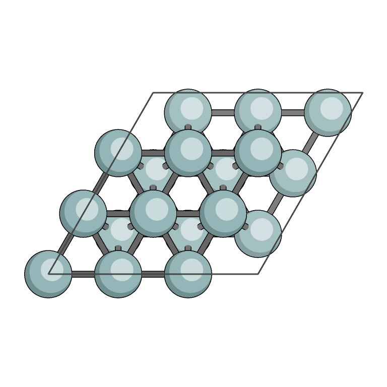
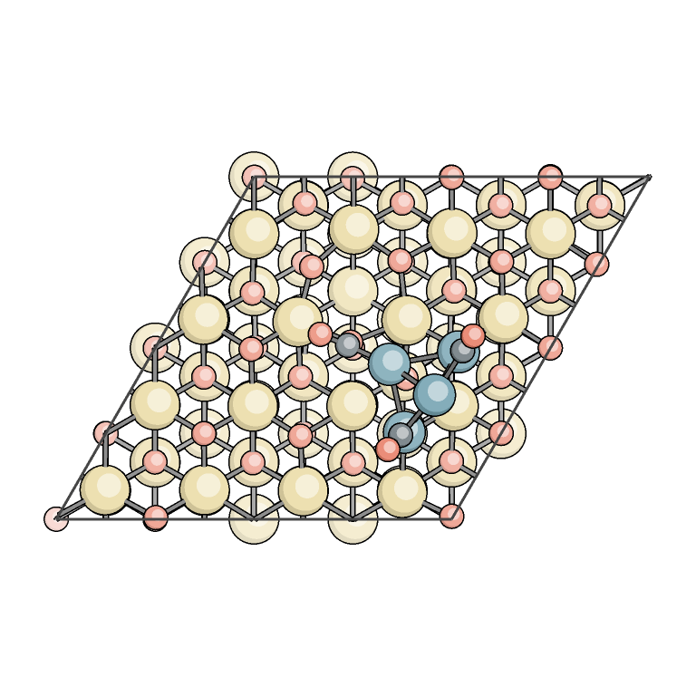
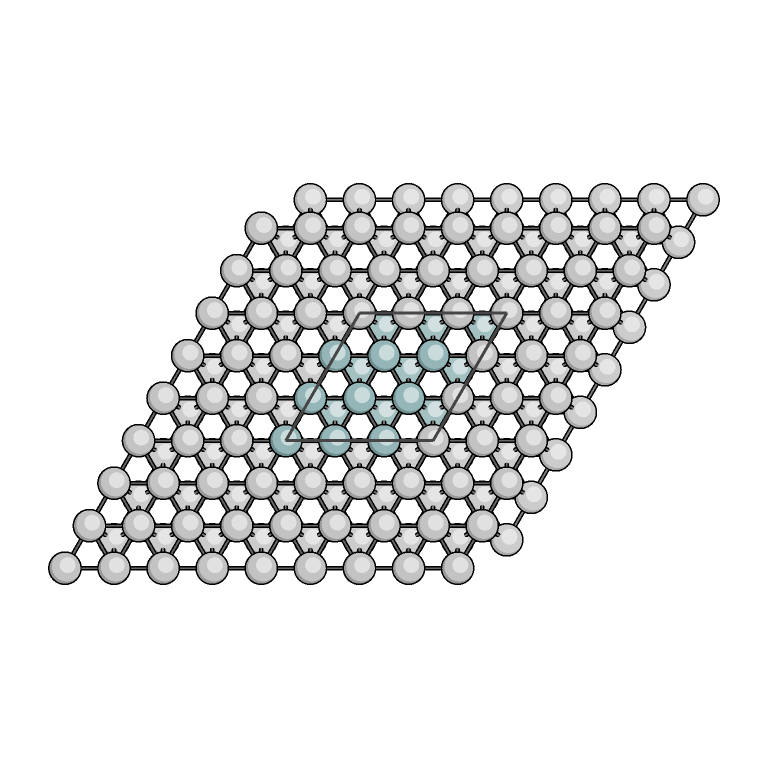

[](https://github.com/ifilot/qasr/actions/workflows/image-libs.yml)
[](CMakeLists.txt)
[](https://github.com/ifilot/qasr/tree/v0.6.0)

# QASR: Quick Atomic Structure Renderer

QASR turns atomic structures into images from the command line, without a graphical interface.

- Read VASP, XYZ/Extended XYZ, Gaussian and AMS geometry files.
- Render molecules, crystals and slabs with configurable views, colors and drawing styles.
- Save PNG images, or enable optional JPEG and lossless WebP output.
- Enable optional FFmpeg support for camera-orbit and fixed-camera reaction
  movies; see the [movie guide](docs/movies.md) and [examples](examples/movies/README.md).
- Automate repeated renders with JSON settings and batch jobs.
- Add polygon faces and atom-colored bond halves; see the
  [zeolite examples](examples/zeolite/README.md) and [feature guide](docs/polygon-faces.md).
- Draw bonds between displayed atoms and style unit-cell edges with dashes and
  white contours; see the [cell-line examples](examples/cell-lines/README.md).

See the [documentation index](docs/README.md) for current guides and archived
release/validation records. The [user handbook](https://ifilot.github.io/qasr/) covers detailed usage,
[supported input formats](docs/input-formats.md) and [drawing styles](docs/render-styles.md).
See the [v0.6.0 release notes](docs/release-v0.6.0.md) for changes and limitations.
See the [feature performance report](docs/performance-features.md) for the
polygon, cell-line and movie optimization measurements and reproduction steps.

## Examples

Rendered with QASR. Click an image to view it at full size.

| Illustrated cobalt surface | Palladium on ceria | Periodic surroundings |
| :---: | :---: | :---: |
| [](docs/website/assets/co-illustrated.png) | [](docs/website/assets/pd-ceria.png) | [](docs/website/assets/co-periodic-greyscale.png) |
| **ORTEP spherical style** | **BALSAC-inspired style** | **Dualtone dithering** |
| [](docs/website/assets/co-ortep.png) | [](docs/website/assets/co-balsac.png) | [](docs/website/assets/co-balsac-dualtone.png) |

Find rendering recipes in the [handbook gallery](https://ifilot.github.io/qasr/#gallery)
and [style guide](docs/render-styles.md).

## Installation and compilation

On Debian or Ubuntu, install the build dependencies:

```sh
sudo apt update
sudo apt install build-essential cmake git pkg-config libpng-dev libdeflate-dev libxml2-dev
```

You need a C11 compiler with OpenMP support and CMake 3.16 or newer.
Clone and compile QASR:

```sh
git clone https://github.com/ifilot/qasr.git
cd qasr
cmake -S . -B build -G "Unix Makefiles" -DCMAKE_BUILD_TYPE=Release -DBUILD_TESTING=OFF
cmake --build build --parallel
```

The executable is `build/qasr`. For a system-wide installation:

```sh
cd build
sudo make install
qasr --version
cd ..
```

Run `sudo make install` from the CMake build directory. With the default prefix,
it installs `/usr/local/bin/qasr`, presets and schemas under
`/usr/local/share/qasr/`, and documentation including [SKILL.md](SKILL.md) under
`/usr/local/share/doc/qasr/`. Build as your ordinary user; only installation needs
root access. A different system prefix can be selected at configuration time
with `-DCMAKE_INSTALL_PREFIX=/your/prefix`.

To install for your user instead, run from the source directory:

```sh
cmake --install build --prefix "$HOME/.local"
```

Add `$HOME/.local/bin` to your `PATH` to run `qasr` from any directory.

[SKILL.md](SKILL.md) provides an assistant-oriented usage guide for input
inspection, figures, faces/bonds, movies, reproducible recipes and batch jobs.

For JPEG and WebP output, install the optional libraries and rebuild:

```sh
sudo apt install libjpeg-dev libwebp-dev
cmake -S . -B build -DENABLE_JPEG=ON -DENABLE_WEBP=ON
cmake --build build --parallel
```

To run the test suite, install Python 3, configure with `-DBUILD_TESTING=ON`,
rebuild, and run `ctest --test-dir build --output-on-failure`.

For movies, install `libavcodec-dev libavformat-dev libavutil-dev libswscale-dev`
and configure with `-DENABLE_FFMPEG=ON`. This links shared FFmpeg libraries and
streams MP4 frames directly, without a separate `ffmpeg` process or PNG sequence.
The option defaults to OFF; `qasr --build-info` reports `ffmpeg: true` when enabled.

## Minimal working example

From the repository directory, render the included sample structure:

```sh
./build/qasr tests/fixtures/POSCAR.skew -o structure.png
```

This creates `structure.png` in the current directory. Replace the sample path
with your own structure file to render it. Run `./build/qasr --help` for options,
or follow the [user handbook](https://ifilot.github.io/qasr/) for more examples.

## License

QASR is licensed under the [GNU General Public License v3.0 only](LICENSE).
See [third-party notices](THIRD_PARTY_NOTICES.md) for dependency licenses.
