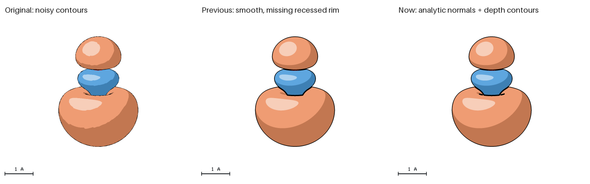

# Orbital implementation: refactor, commenting and optimization review

Review date: 2026-11-01. Scope: the new C11 orbital loader, shared triangle types,
scene/configuration ownership, projected surface rendering, geometric contours,
JSON/worker integration, the CO example and release documentation. Applied
`architecture-simplifier` in Refactor mode and `commenting-auditor` in Fix mode.
Vendor code and unrelated algorithms were not refactored. This is a scoped
engineering review; it does not establish repository-wide absence of defects.

## Architecture and ownership

The internal `geometry` static target owns these modules and depends on cjson,
libm and the configured image/input libraries. `qasr` links that target. There is
no installed C library ABI.

1. Configuration calls `config_orbitals` in `src/orbitals.c`, owning copied JSON,
   hashes and decoded world-space triangles. `config_orbitals_free` is the single
   release/reset operation, including partial loads.
2. `src/surface.h` defines shared Cartesian triangle values in angstroms. Scene
   construction copies imports into its independent owned triangle array.
3. `src/face_render.c` projects triangles and owns bins, sample coverage, contour
   scratch and composition with atoms/polygons. `src/surface_render.h` contains
   private projected values and the narrow contour interface.
4. `src/mesh_contours.c` computes geometric silhouette/phase/self-occlusion
   distances from borrowed projected triangles into caller-owned storage. It
   neither parses files nor owns scene/configuration memory.

The static target boundary is retained: separate targets, opaque managers and
callback layers would add moving parts without a current ABI/plugin requirement.
Scene copies remain intentional, because configurations and worker caches have
independent lifetimes. Imported normals remain independent from geometric contour
placement; this preserves the accepted recessed-rim rendering.

## Prioritized findings and applied fixes

| Priority | Evidence and impact | Minimal applied fix and tradeoff |
| --- | --- | --- |
| Medium, resolved | The loader and configuration serializer included `scene.h`, importing scene/atom-style APIs just to access triangle storage. This reversed the intended configuration-to-scene direction. | Move the shared value type to `src/surface.h:8`; loader/serializer now include that header. Two avoidable direct scene includes removed. The value type remains concrete because there is no library ABI to hide. |
| Medium, resolved | Mesh contour policy and polygon composition occupied the same translation unit; changing a fold heuristic required reading the layer-compositing implementation. | Isolate policy in `src/mesh_contours.c:57` and keep private projected data in `src/surface_render.h:9`. One narrow helper boundary; no forwarding object or new runtime ownership. |
| Medium, resolved | Unoutlined/shaded meshes still allocated a distance image and ran both contour transforms. | Gate allocation and propagation in `src/face_render.c:130`. Save one four-byte float per supersample (12.288 MB for 480×400 at 4× AA), while retaining nearest-surface coverage needed for depth composition. |
| Medium, resolved | PLY decoding read each binary scalar/index separately; contour propagation repeatedly called the library finite/NaN minimum. | Read one bounded packed record per vertex/face (`src/orbitals.c:80`), retain endian decoding and strict truncation checks. Use ordered minima only for finite contour values (`src/mesh_contours.c:5`); generic floating-point behavior is not changed elsewhere. Reuse the normal length during shading. |
| Major documentation issue, resolved | The new import API lacked full parameter/ownership/failure contracts; projected depths could be confused with angstroms. | Document `src/config.h:100`, the loader and raster helpers, shared world-space values and the private contour declaration. Explicitly distinguish mesh-unit origins, angstrom positions, dimensionless normals, supersample coordinates, borrowed scene pointers and partial failures. |
| Minor, resolved | Experimental figures and scripts cluttered the runnable example, and a regression test read its reference from an experiment directory. | Keep final assets under `meshes/`, `recipes/` and `renders/`; move experiments to ignored artifacts and the core reference to `tests/fixtures/orbitals/`. Update recipe-relative paths, generators, gallery links, tests and downloads. |

No Critical finding remains within this inspected scope. Retaining configuration
fields alongside other decoded faces/rules follows the existing lifecycle rather
than introducing an additional manager. Header-only isolation without runtime
storage changes was preferred over a broad rewrite of all polygon/mesh types.

## Measured results

The orbital example fell from **85 to 45 files**, excluding Python caches. Its
working top level contains seven files; inputs, recipes and final renders are
separated. The required scientific meshes are retained. Historical zeolite and
cell-line provenance remains with those examples because their manifests use it.

The baseline is the accepted orbital implementation immediately before this
cleanup, including the depth-aware recessed-rim fix. The following are median complete CLI times in milliseconds, from seven paired,
interleaved warm-cache runs per executable and case. Meshes are staged on the same
temporary filesystem; output is 480×400 with 4× AA and four threads. Timings
include startup, hashing/loading, rendering and PNG encoding. They exclude
wavefunction/mesh generation. Exact commands, raw samples, executable hashes and
PNG hashes are in [the benchmark data](orbital-benchmark.json). Variability and
host/filesystem differences limit generalization; these are observed workflows,
not an across-the-board speed guarantee.

| MO | Style | Outline px | Baseline ms | Refactored ms | Reduction | PNG identical |
| --- | --- | ---: | ---: | ---: | ---: | --- |
| 2 | illustrated | 1.5 | 146.3 | 123.0 | 15.9% | yes |
| 2 | illustrated | 0 | 147.1 | 49.5 | 66.3% | yes |
| 2 | shaded | 1.5 | 142.9 | 48.1 | 66.3% | yes |
| 7 | illustrated | 1.5 | 217.7 | 190.7 | 12.4% | yes |
| 7 | illustrated | 0 | 218.3 | 113.6 | 48.0% | yes |
| 7 | shaded | 1.5 | 217.6 | 114.1 | 47.6% | yes |
| 10 | illustrated | 1.5 | 220.2 | 197.8 | 10.1% | yes |
| 10 | illustrated | 0 | 218.0 | 118.2 | 45.8% | yes |
| 10 | shaded | 1.5 | 225.9 | 123.4 | 45.4% | yes |

All nine encoded PNG pairs are byte-for-byte identical. Outlined workflows are
about 10–16% faster; unoutlined/shaded workflows are about 45–66% faster in this
run. The loader now makes one `fread` per vertex and one per binary face rather
than one per scalar/index. No claim is made about total include/fan-in counts or
repository-wide dependency cycles; the two removed direct includes are the
measured header-coupling change.

## Change locality

| Representative change | Production changes | Necessary external boundaries |
| --- | --- | --- |
| Adjust the same-phase depth-gap rule | `src/mesh_contours.c` | Geometric regression tests and the contour guide; no PLY/configuration/scene changes |
| Replace binary PLY record decoding or add a supported PLY scalar layout | `src/orbitals.c` | Parser fixtures and documented PLY subset; scene/compositor unchanged |
| Add a new length-unit spelling | `src/orbitals.c` validation/conversion | JSON schema, unit tests and user guide intentionally change with the public input contract; world-space scene/render types stay in angstroms |

The retained `FaceTriangle` value and private projected representation are
concrete because they are inexpensive internal data contracts. Supporting a
materially different rendering model would require revisiting that assumption.

## Commenting audit

Examined `config.h`, `surface.h`, `surface_render.h`, `orbitals.c`,
`mesh_contours.c`, modified raster helpers and the existing scene/render contracts.
The CMake target is ISO C11 without compiler language extensions; no C++ policy
was imposed. No repository AGENTS.md was found in this workspace or its ancestor
path. No Doxygen generation/configuration was introduced.

Applied full caller-facing Doxygen at declarations and scoped static-helper
contracts where no declaration exists. Implementation comments explain finite
minimum assumptions, PLY unit conversion, bounding/cleanup behavior and contour
geometry rather than repeating each statement. Existing header contracts are not
duplicated at their public definitions. No unresolved contract contradiction was
found in the scoped review; resource budgets remain allocation charges rather
than a measurement of allocator-internal transient memory.

## Validation

- `cmake --build build --parallel 4`: Release build with warnings enabled.
- `ctest --test-dir build --output-on-failure --parallel 4`: **22/22 passed**.
- `cmake -S . -B /tmp/qasr-070-asan -DENABLE_SANITIZERS=ON -DBUILD_TESTING=ON -DCMAKE_BUILD_TYPE=Debug`, build, then `ctest --test-dir /tmp/qasr-070-asan --output-on-failure --parallel 2`: **22/22 passed**, with AddressSanitizer, UndefinedBehaviorSanitizer and LeakSanitizer. External execution permits the XML loopback fixture and avoids ptrace restrictions on leak checks.
- GCC `-fanalyzer` compilation of `src/orbitals.c` and `src/mesh_contours.c`, with C11 and normal warning flags: no diagnostics. clang/clang-tidy were not installed.
- Standalone C11 `-Wall -Wextra -Werror -fsyntax-only` checks: `config.h`, `surface.h`, `surface_render.h`, `scene.h`, `render.h` compile independently.
- `python3 tools/benchmark_orbitals.py /tmp/qasr-v070-baseline build/qasr artifacts/orbitals-development/final-optimization.json`: nine paired image-parity checks passed.
- The accepted CO rim, unchanged smooth core control, three AA settings, steep continuous slopes, phase/atom occlusion, malformed/truncated PLYs, unit conversions and worker cache invalidation are covered by the 11 MO tests.

This was Refactor/Fix work, not a read-only audit. Scientific calculations and
atom/polygon rendering semantics are preserved. The optional JPEG/WebP/FFmpeg/Cairo Release build passed **24/24** tests with
`ctest --test-dir /tmp/qasr-070-all --output-on-failure --parallel 4`. The private
install reported v0.7.0 and rendered the installed CO HOMO recipe successfully.
Source-package and handbook checks are part of the release handoff.

### Packaging and handbook results

The source archive was extracted under `/tmp/qasr-070-source-check` and built with
`-DENABLE_OPENMP=OFF -DENABLE_XML=OFF -DENABLE_LIBDEFLATE=OFF -DBUILD_TESTING=OFF`.
That executable reported v0.7.0 and rendered the packaged CO HOMO. Its decoded
pixels and the private install's decoded pixels matched the accepted HOMO exactly.
This minimal source build was a build/render check, not an additional full suite.

The standalone CO ZIP rendered successfully after extraction. Regeneration with
`package_source.py`, the documentation/configuration/options builders and
`build_orbital_documentation.py`, followed by
`python3 tools/check_documentation.py build/qasr`, passed: **323 local links,
28 image records, current source hashes and the unchanged legacy archive**.
Generated source downloads exclude the website to prevent recursive archives;
private artifacts, credentials and Python caches are excluded. The shared example
is runnable from the installed docs, source archive and standalone download.
