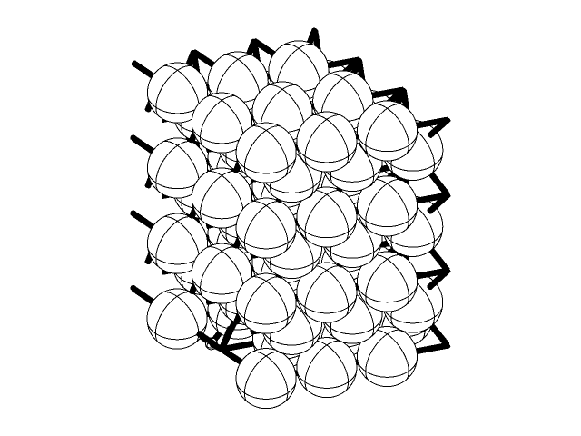
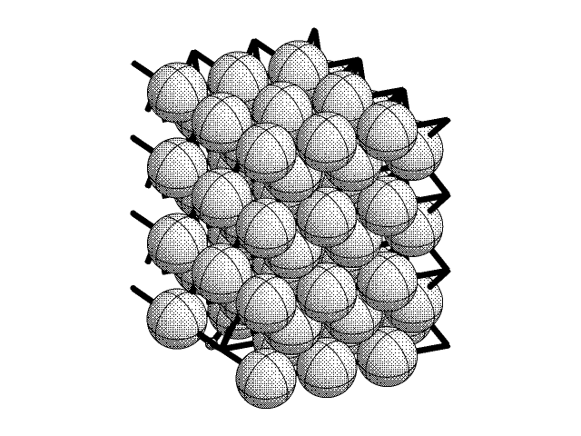
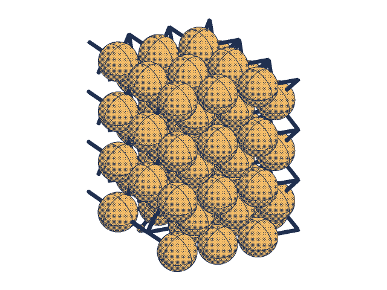
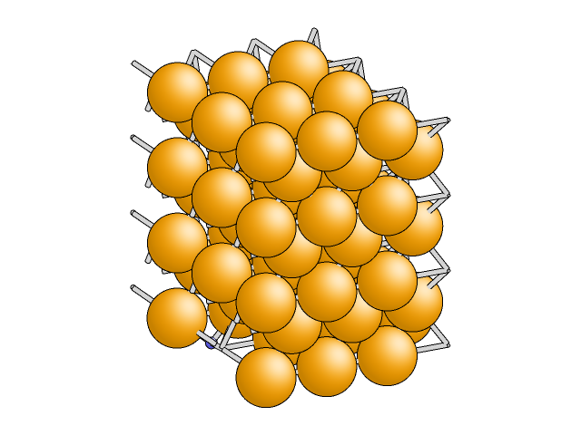
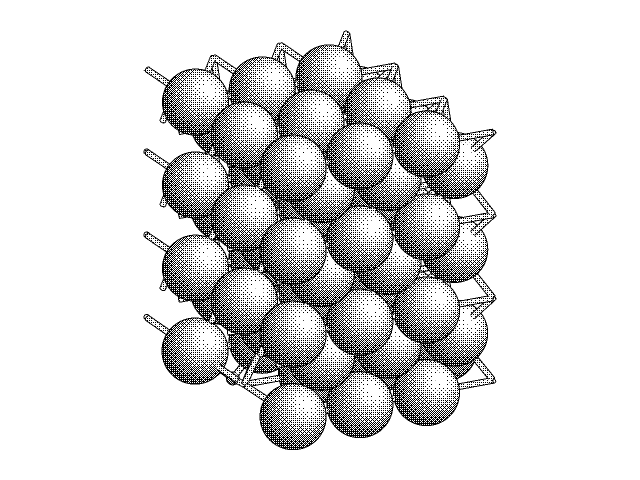
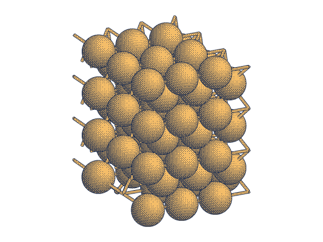

# ORTEP spherical and BALSAC-inspired drawing

Use `--style ortep` or `--style balsac`, or set JSON `image.style`.
See the README for behavior, presets and backend limitations.

Add `--tone monocolor` for black/white dithering or `--tone dualtone` for
navy/gold dithering. The shared atom/bond palette ignores element RGB and retains
alpha; `--tone color` restores the normal appearance. Dots use an output-pixel
8×8 Bayer matrix, shared across supersamples. Cell edges, backgrounds and
annotations use their configured appearance. Antialiasing blends edge colors.

| Style | Color | Monocolor | Dualtone |
| --- | --- | --- | --- |
| ORTEP |  |  |  |
| BALSAC |  |  |  |

## Reproduce the handbook images

From a complete checkout with a built executable:

```sh
build/qasr tests/fixtures/slabs/02_co0001_h2_dissociated/CONTCAR --no-user-config --config presets/ortep.json --width 640 --height 480 --view 1,-1,1.3 -o docs/website/assets/co-ortep.png
build/qasr tests/fixtures/slabs/02_co0001_h2_dissociated/CONTCAR --no-user-config --config presets/balsac.json --width 640 --height 480 --view 1,-1,1.3 -o docs/website/assets/co-balsac.png
for style in ortep balsac; do
  for tone in monocolor dualtone; do
    build/qasr tests/fixtures/slabs/02_co0001_h2_dissociated/CONTCAR --no-user-config --config presets/$style-$tone.json --width 640 --height 480 --view 1,-1,1.3 -o docs/website/assets/co-$style-$tone.png
  done
done
```


## Validation

- Three additional test groups cover dither palette endpoints, directional
  shading, alpha, element-color independence, dot retention under supersampling,
  thread determinism, invalid tone/style combinations, all embedded schemas,
  dump/reload, CLI precedence and cached-worker switching across all six variants.

- Direct GCC C11 builds with the project's warning flags, with and without
  OpenMP; libpng output, XML and libdeflate disabled.
- Seven new style test groups: independent projected-great-circle oracle for
  oblique and axial views, silhouettes and ink width, smooth colors, hidden
  atoms, crossing bonds, alpha, annotations, geometry invariance, sampling,
  thread determinism, CLI/config round trips, embedded schemas, JSON jobs,
  cached-worker style switching and explicit Cairo rejection.
- Existing scene/render suite, including fixed golden pixel hashes and all
  twenty user slabs; CLI/parser, configuration, overlays, periodic context,
  worker, synthetic workload, benchmark-tool and encoder suites.
  The XML-disabled capability test passes; XML-dependent tests and unavailable
  optional encoders are skipped in this local build.
- SHA-256 and PNG allocation/work-budget C gates pass.
- AddressSanitizer/UndefinedBehaviorSanitizer rendering and cached-worker checks
  pass with leak checking disabled in a local test-only runtime hook.
  The strict JSON-stderr test cannot pass under this sandbox's sanitizer runtime
  because it prints executable-name warnings before the JSON error. The normal
  build passes that contract test.

CMake and development headers are unavailable in the editing environment.
Local builds used upstream libpng headers matching the installed system library.
The added CI workflow runs normal CMake/CTest builds with XML, OpenMP and
libdeflate enabled, with Cairo both OFF and ON. These CI checks must pass before
merging; no optional dependency or test-only runtime hook is added to QASR.
