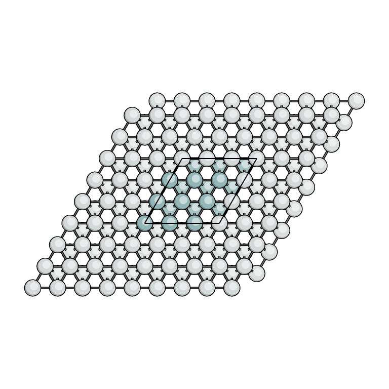
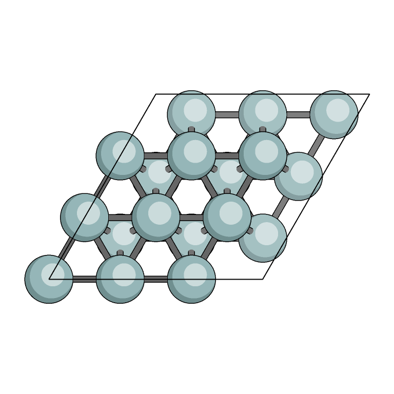
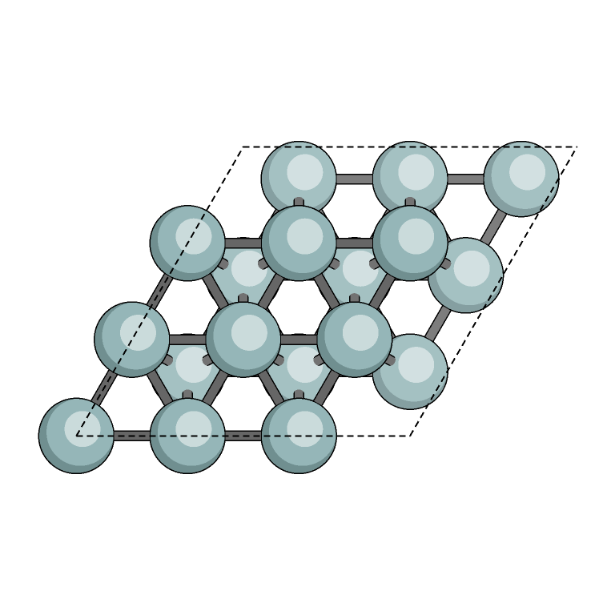
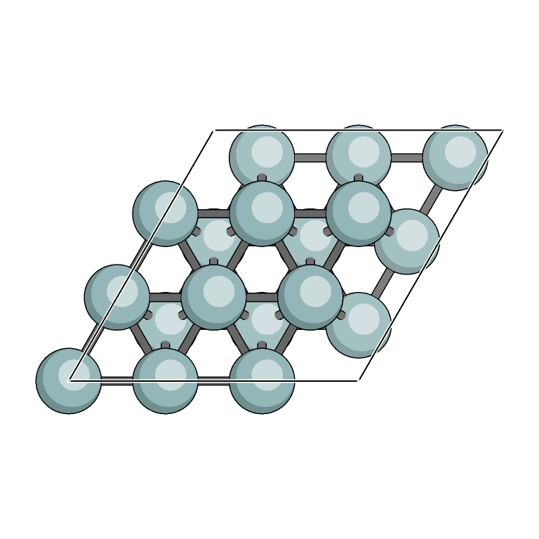
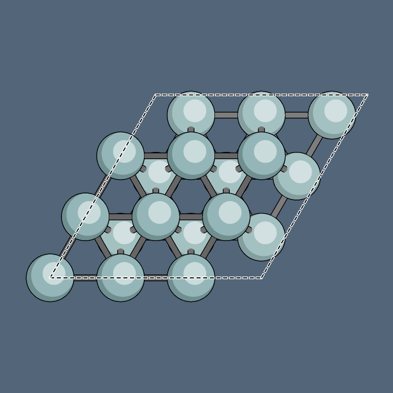

# Complete bond endpoints and unit-cell lines

These QASR images use the supplied cobalt slab and illustrated top-view recipe.
Open the [comparison sheet](comparison.png) or full-size images below.
Configurations and reports are beside the images.

| XY expansion: neighboring atoms included | One cell: both endpoints inside |
| --- | --- |
|  |  |

| Dashed black | Solid black with a white contour |
| --- | --- |
|  |  |

| Dashed black with a white contour | Contrast on a dark background |
| --- | --- |
|  |  |

Endpoint membership is mandatory: every bond connects two included atom
instances. The single-cell example has 208 complete bonds and no missing
endpoints. The xy-expanded example has 567 atoms and 2,704 complete bonds,
including connections between the primary cell and its neighbors,
while omitting connections beyond the outermost displayed cells. Primary-cell
atoms stay colored, and periodic neighbors are muted. Physical distance cutoffs
are the same. No option enables clipped stubs to absent atoms.

Regenerate from the repository root:

```sh
python3 tools/render_cell_examples.py build/qasr
```

The helper uses the standard library for QASR renders and optional Pillow for
the comparison sheet. `manifest.json` records hashes, commands, counts and
endpoint checks. See the [usage guide](../../docs/cell-lines.md). Original fixture
coordinates are unchanged.
