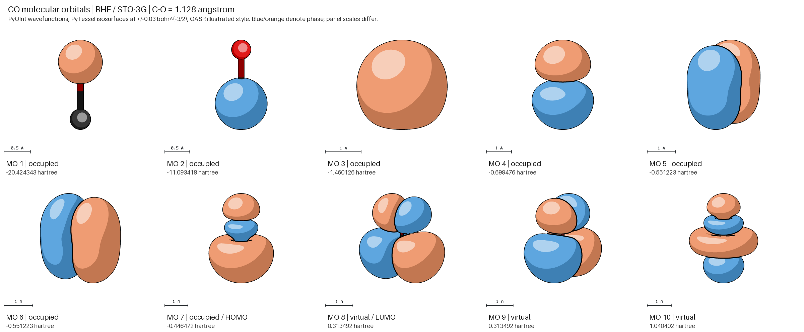

# Carbon monoxide molecular orbitals

[Open the HTML gallery](gallery.html) or [view the full image gallery](gallery.png).



These are actual PyQInt RHF/STO-3G wavefunctions, tessellated by PyTessel and
rendered by QASR. Blue and orange denote opposite signs of the orbital amplitude
at ±0.03 bohr⁻³ᐟ². CO has 14 electrons: orbitals 1–7 are doubly occupied;
7 is the HOMO and 8–9 are the degenerate LUMOs. The C–O separation is 1.128 Å,
with carbon below oxygen along z. The total RHF energy is −111.2245151313 hartree.
STO-3G is a minimal illustrative basis, not a converged prediction.

Each panel fits its own bounds and includes a physical scale bar. Apparent lobe
sizes should therefore be compared using those bars. Opaque surfaces can hide
the atoms and inner nodal shells. A single isovalue does not display every node.
The two core orbitals are concentrated on O and C respectively.

The checked-in PLY files are the binary output of PyTessel's `write_ply`,
with PyTessel vertices in bohr and analytic PyQInt gradient normals. Their configuration layers explicitly
convert them to ångströms. Geometry in `co.xyz` is already in ångströms.
The [manifest](manifest.json) records energies, occupations, package versions,
conversion constant, grid shape and spacing. See the
[MO support guide](../../docs/molecular-orbitals.md) for formats and unit conventions.

To render one orbital from the repository root (no Python dependencies):

```sh
./build/qasr examples/orbitals/co.xyz --no-user-config \
  --config examples/orbitals/recipes/co-07.json -o co-homo.png
```

To regenerate the calculation, meshes, individual images and galleries:

```sh
python3 -m venv /tmp/qasr-mo-venv
/tmp/qasr-mo-venv/bin/pip install -r examples/orbitals/requirements.txt
OMP_NUM_THREADS=4 OPENBLAS_NUM_THREADS=1 \
  /tmp/qasr-mo-venv/bin/python examples/orbitals/generate.py
```

Use `--render-only` to reuse the included meshes, or `--qasr /path/to/qasr` to
select another executable. The script works from any directory. The calculation
uses a 121³ endpoint-exclusive grid spanning a 14-bohr cube; its axis/origin
checks run before tessellation. A different eigensolver may reverse orbital
signs or rotate degenerate pairs; their energies and occupied subspaces agree.

References: [PyTessel](https://github.com/ifilot/pytessel),
[PyQInt](https://github.com/ifilot/pyqint), and
[PyQInt's PLY workflow](https://ifilot.github.io/pyqint/orbital_visualization.html).

## Files and rendering quality

- `meshes/`: PyTessel binary PLY inputs in bohr.
- `recipes/`: ten runnable JSON recipes; mesh paths resolve relative to each recipe.
- `renders/`: accepted final images used by the HTML and PNG galleries.
- `manifest.json`: scientific provenance and recipe paths.

The gallery uses 4× antialiasing, a 121³ grid and analytic orbital-gradient normals.
Depth-aware contours retain recessed same-phase rims without adding marks to the
smooth core control. See the [feature guide](../../docs/molecular-orbitals.md) and
[optimization/review report](../../docs/orbital-review.md).

Development snapshots and experimental comparison scripts are kept locally under
`artifacts/orbitals-development/before-cleanup/`; they are excluded from release
packages. The regression core reference lives under `tests/fixtures/orbitals/`.
