# Point-group symmetry elements

Each image locates one symmetry operation of a small molecule. Open the
[comparison sheet](comparison.png) or the full-size images below. Every image
has a recipe in `recipes/` that works with the listed molecule.

| Water: C2 axis | Water: mirror plane bisecting H-O-H |
| --- | --- |
| [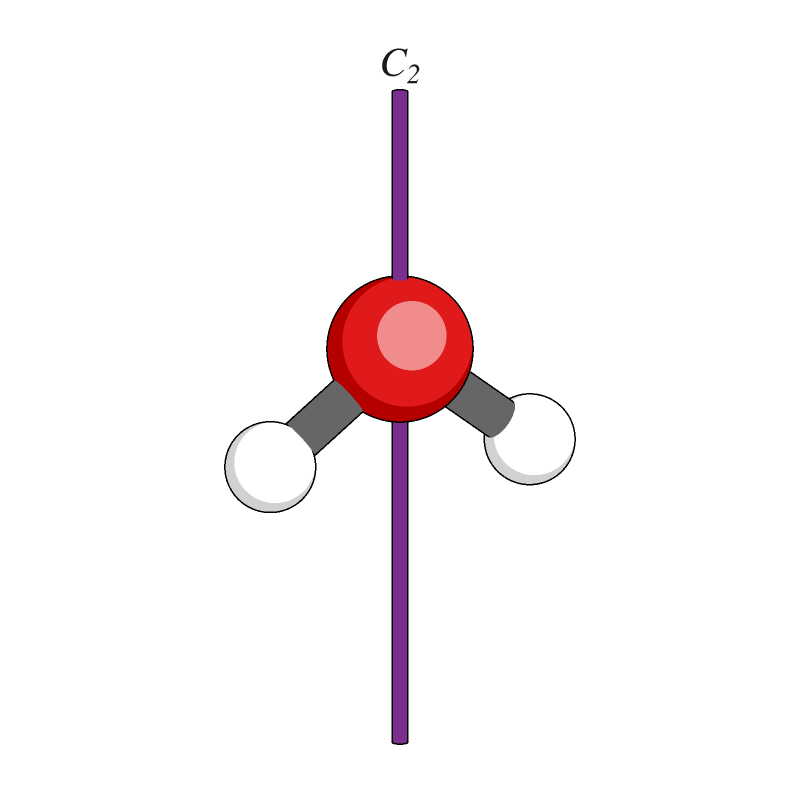](renders/01-water-c2.png) | [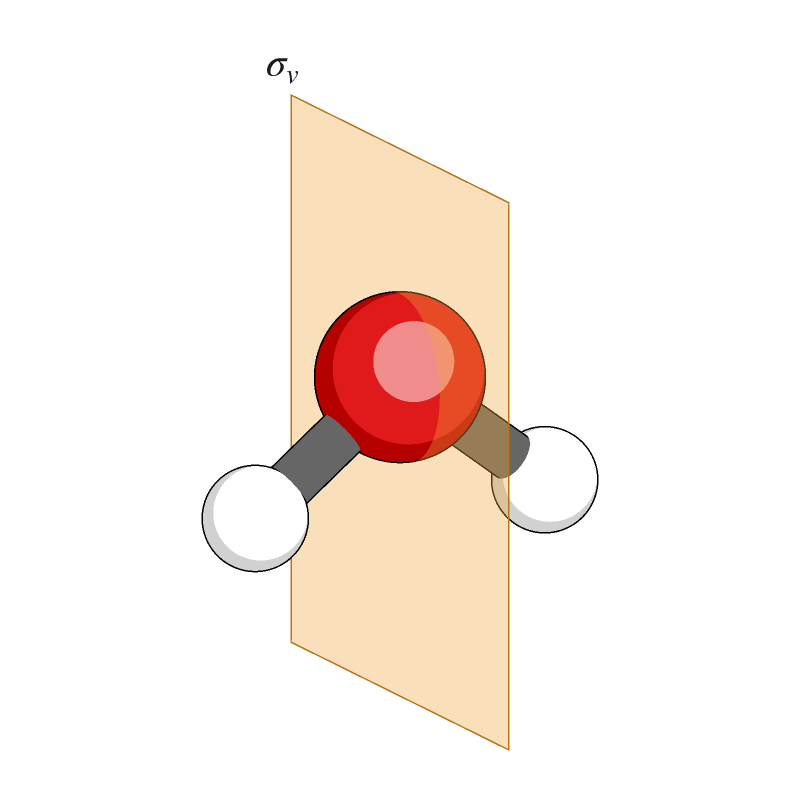](renders/02-water-sigma-v.png) |
| [recipe](recipes/01-water-c2.json), `h2o.xyz` | [recipe](recipes/02-water-sigma-v.json), `h2o.xyz` |

| Water: molecular mirror plane, from its three atoms | Ammonia: C3 axis |
| --- | --- |
| [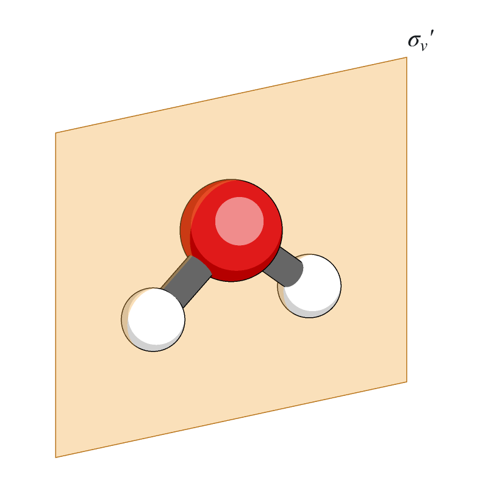](renders/03-water-sigma-v-molecular.png) | [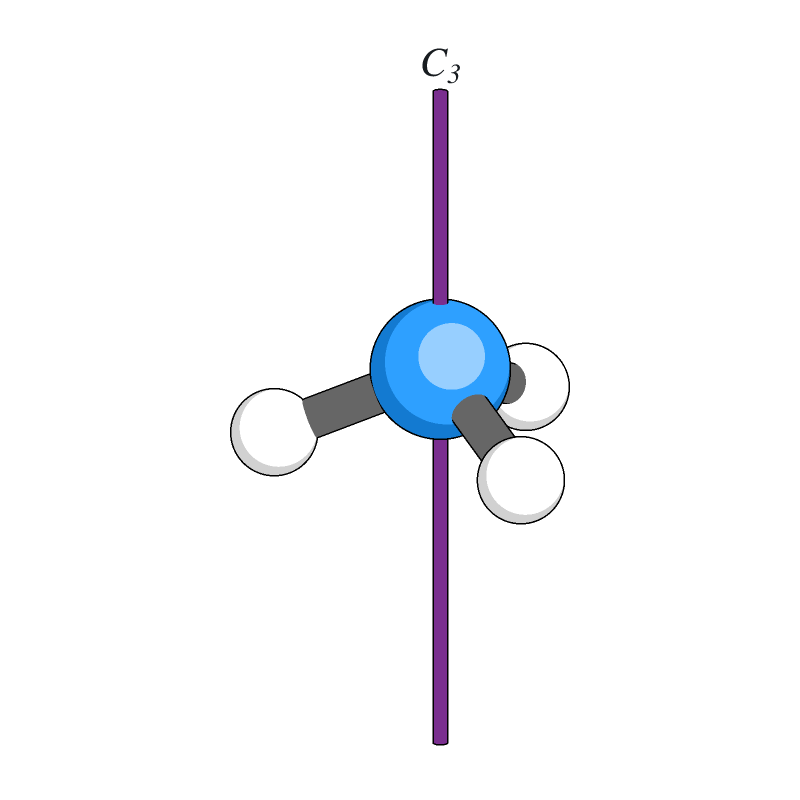](renders/04-ammonia-c3.png) |
| [recipe](recipes/03-water-sigma-v-molecular.json), `h2o.xyz` | [recipe](recipes/04-ammonia-c3.json), `nh3.xyz` |

| Ammonia: one of three vertical mirror planes | Ammonia: identity |
| --- | --- |
| [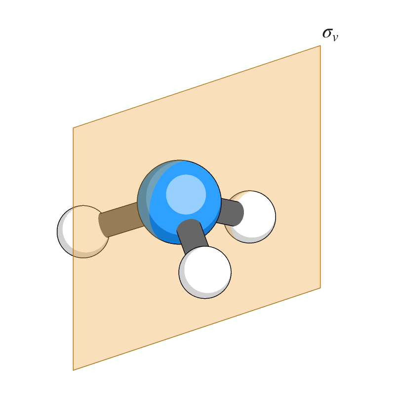](renders/05-ammonia-sigma-v.png) | [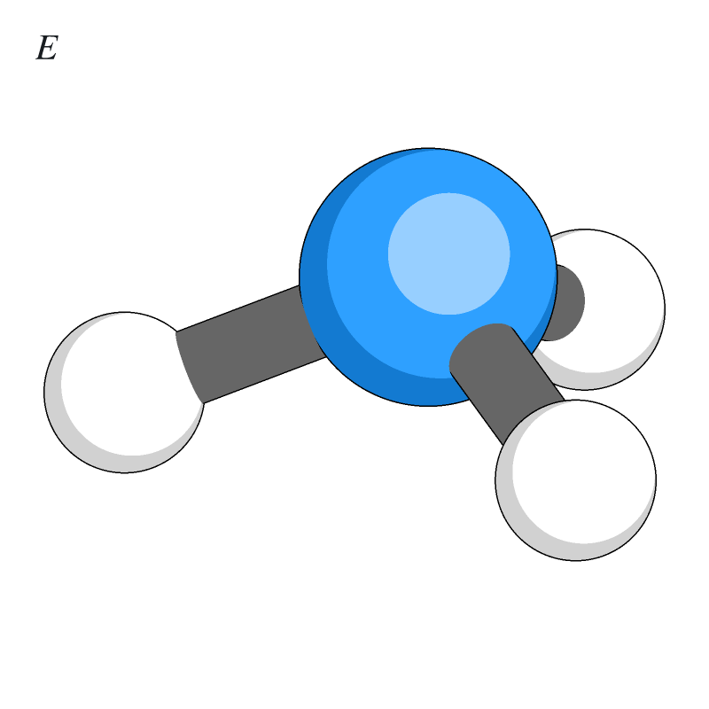](renders/06-ammonia-identity.png) |
| [recipe](recipes/05-ammonia-sigma-v.json), `nh3.xyz` | [recipe](recipes/06-ammonia-identity.json), `nh3.xyz` |

| Benzene: principal C6 axis | Benzene: horizontal mirror plane |
| --- | --- |
| [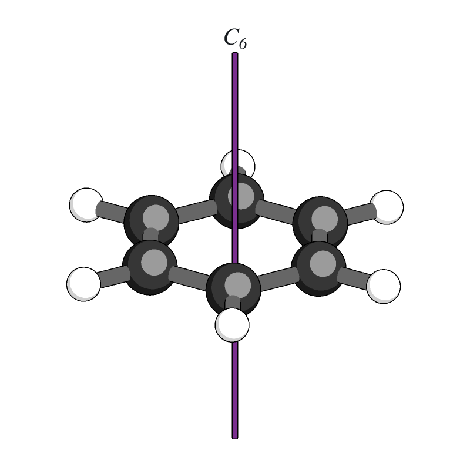](renders/07-benzene-c6.png) | [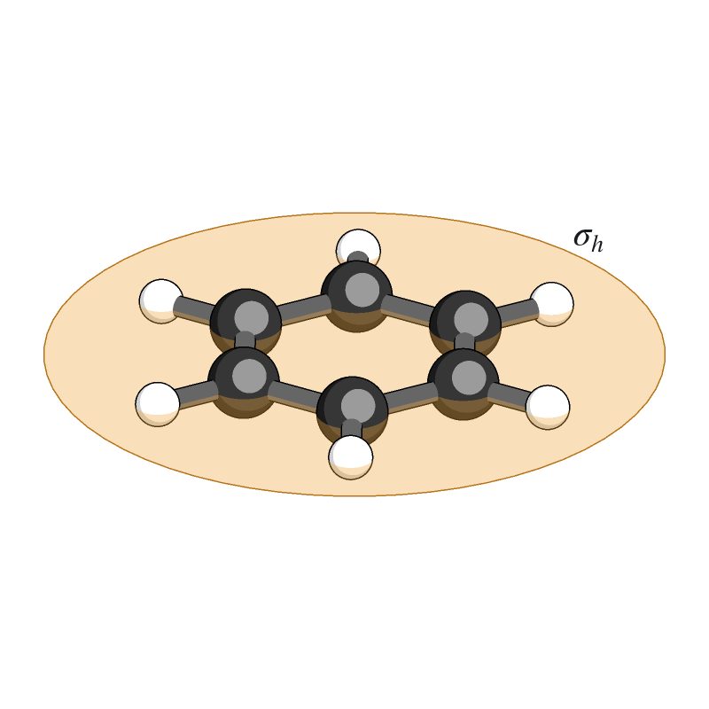](renders/08-benzene-sigma-h.png) |
| [recipe](recipes/07-benzene-c6.json), `benzene.xyz` | [recipe](recipes/08-benzene-sigma-h.json), `benzene.xyz` |

| Benzene: in-plane C2' through two carbon atoms, dashed | Benzene: inversion centre |
| --- | --- |
| [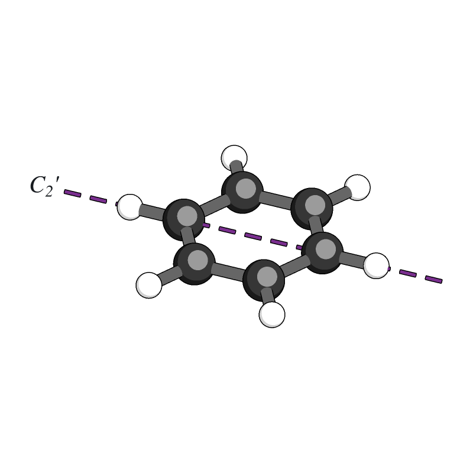](renders/09-benzene-c2-dashed.png) | [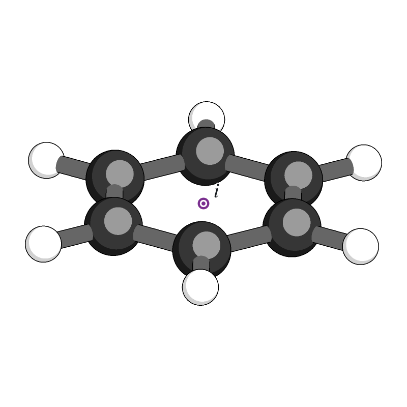](renders/10-benzene-inversion.png) |
| [recipe](recipes/09-benzene-c2-dashed.json), `benzene.xyz` | [recipe](recipes/10-benzene-inversion.json), `benzene.xyz` |

| Staggered ethane: S6 improper rotation | Staggered ethane: inversion centre |
| --- | --- |
| [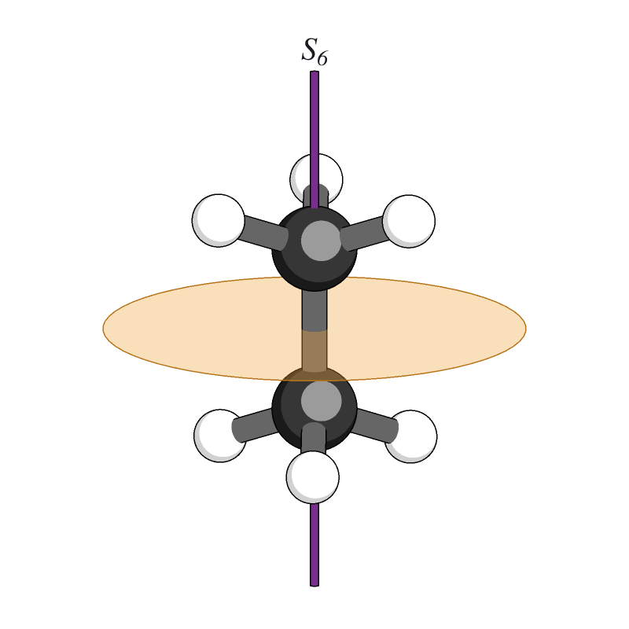](renders/11-ethane-s6.png) | [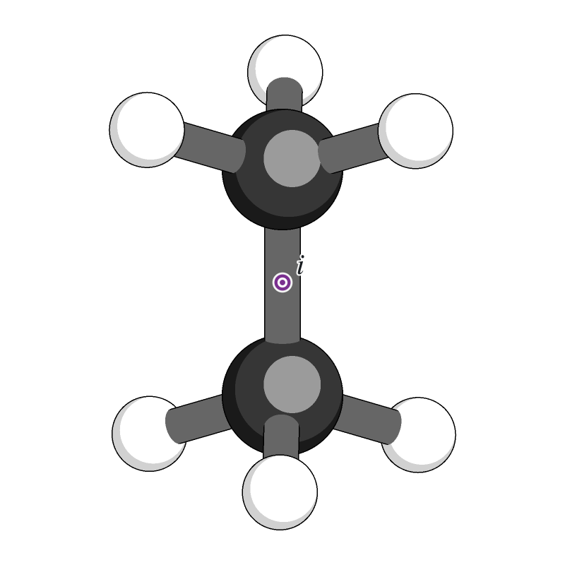](renders/12-ethane-inversion.png) |
| [recipe](recipes/11-ethane-s6.json), `ethane.xyz` | [recipe](recipes/12-ethane-inversion.json), `ethane.xyz` |

| Methane: S4 improper rotation | Boron trifluoride: horizontal mirror plane, sans label |
| --- | --- |
| [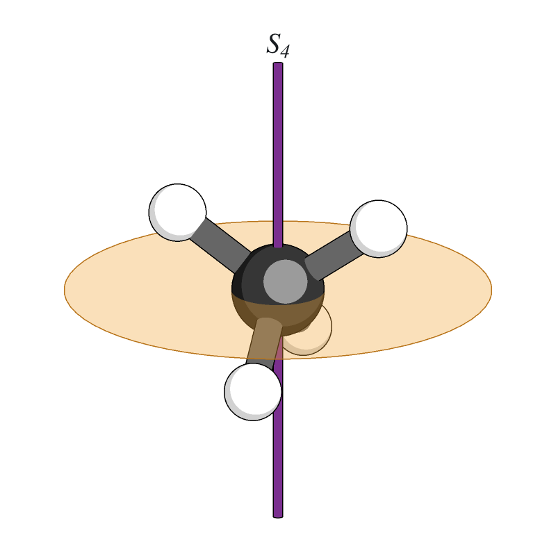](renders/13-methane-s4.png) | [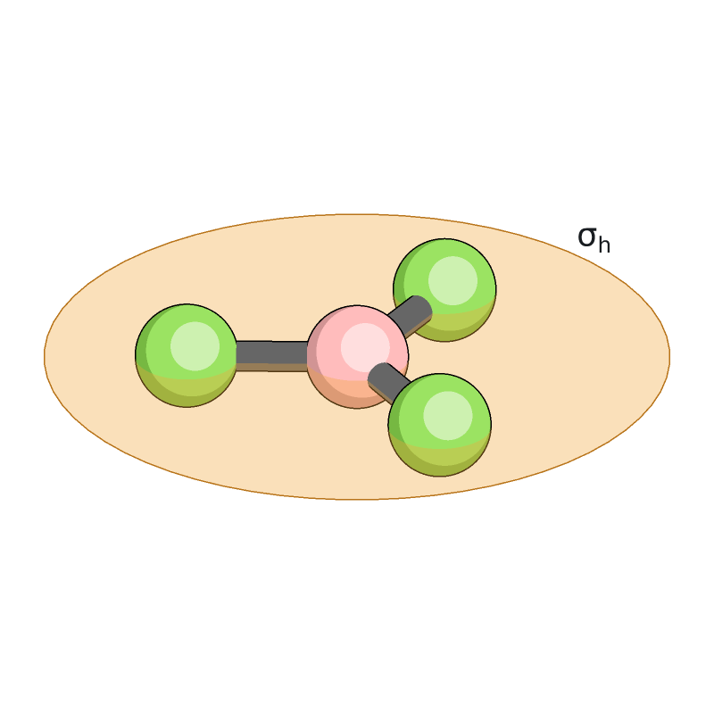](renders/14-bf3-sigma-h.png) |
| [recipe](recipes/13-methane-s4.json), `methane.xyz` | [recipe](recipes/14-bf3-sigma-h.json), `bf3.xyz` |

Render one recipe from the repository root:

```sh
build/qasr examples/symmetry/ethane.xyz \
  --config examples/symmetry/recipes/11-ethane-s6.json -o ethane-s6.png
```

Or name the operation on the command line:

```sh
build/qasr examples/symmetry/nh3.xyz --style illustrated --cell off \
  --view 3,-5,2 --symmetry C3 --symmetry-axis 0,0,1 -o ammonia-c3.png
```

With an FFmpeg build, animate an operation; atom indices make the motion easy
to follow:

```sh
build/qasr --job examples/symmetry/s6-movie-job.json
```

The molecules are idealized geometries built from tabulated bond lengths and
angles, with the principal axis along z. QASR checks that each operation maps
its molecule onto itself; `manifest.json` records the largest deviation found.
Regenerate everything with:

```sh
python3 tools/render_symmetry_examples.py build/qasr
```

The helper uses the standard library for the renders and optional Pillow for
the comparison sheet. See the [usage guide](../../docs/symmetry.md) for all
fields and the verification rules.
