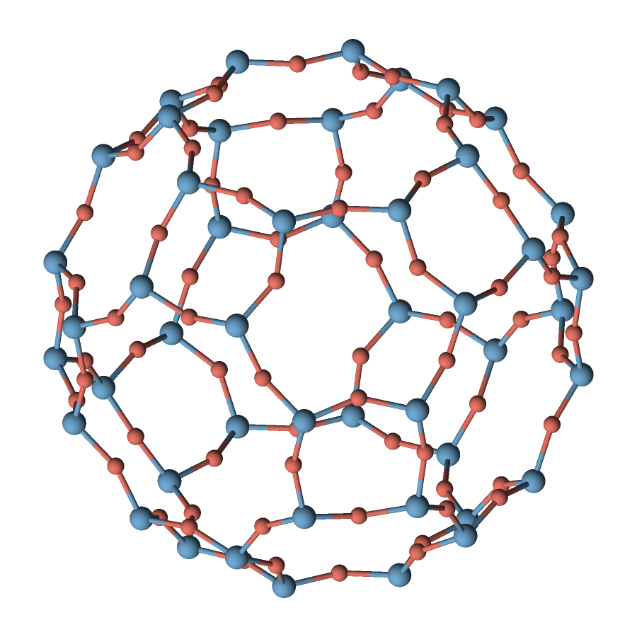
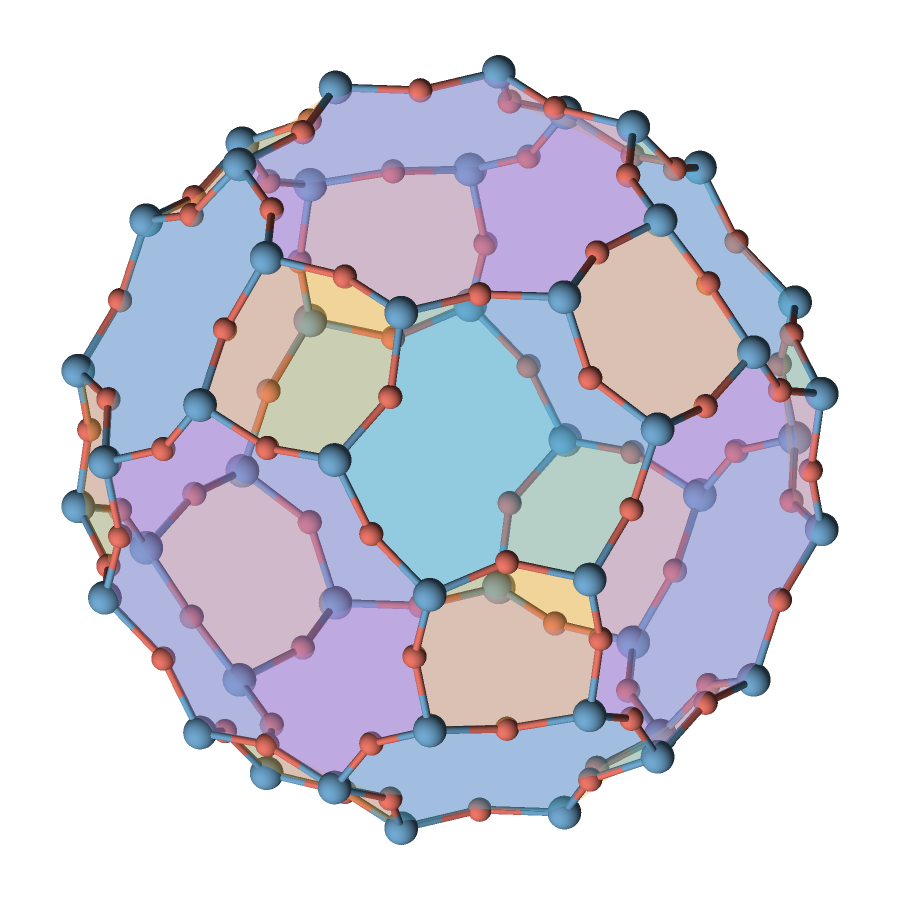
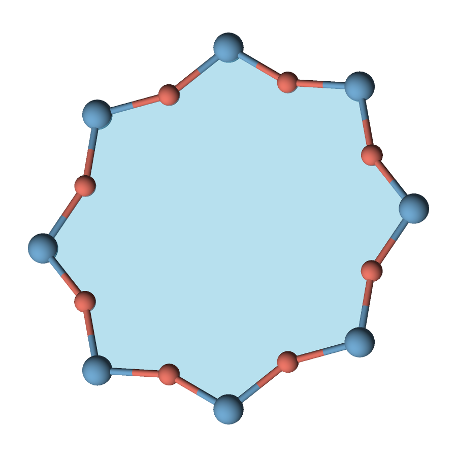
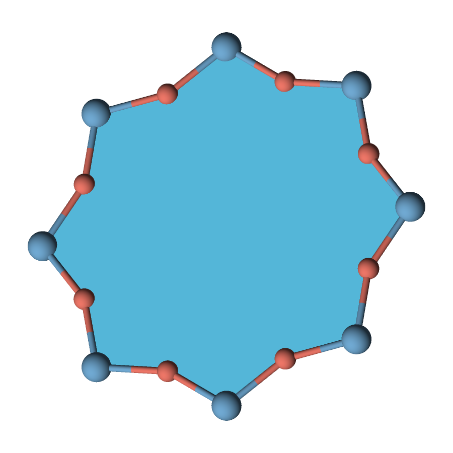
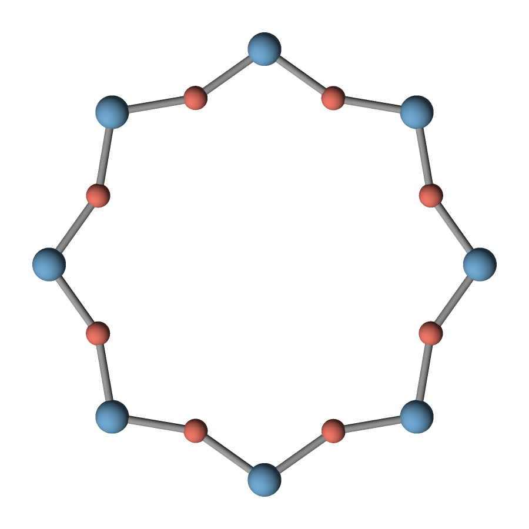
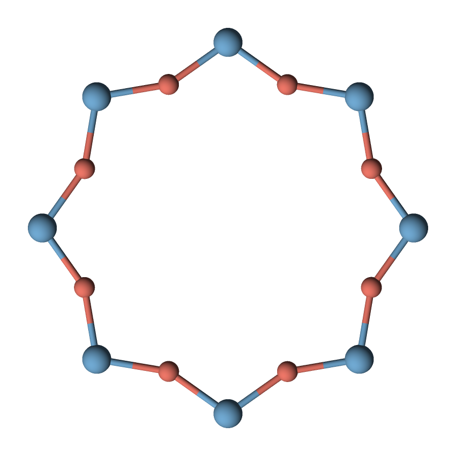
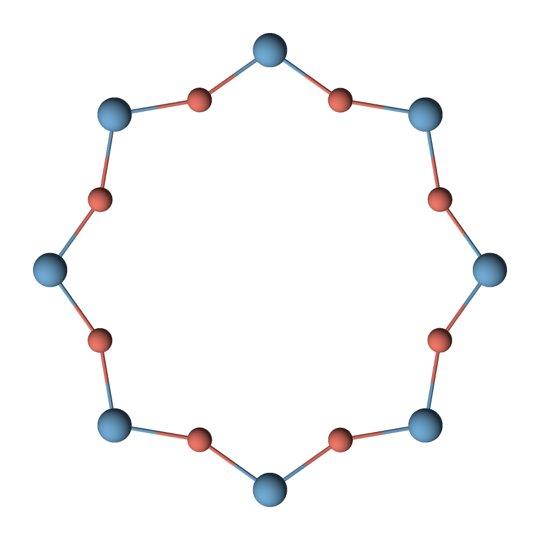
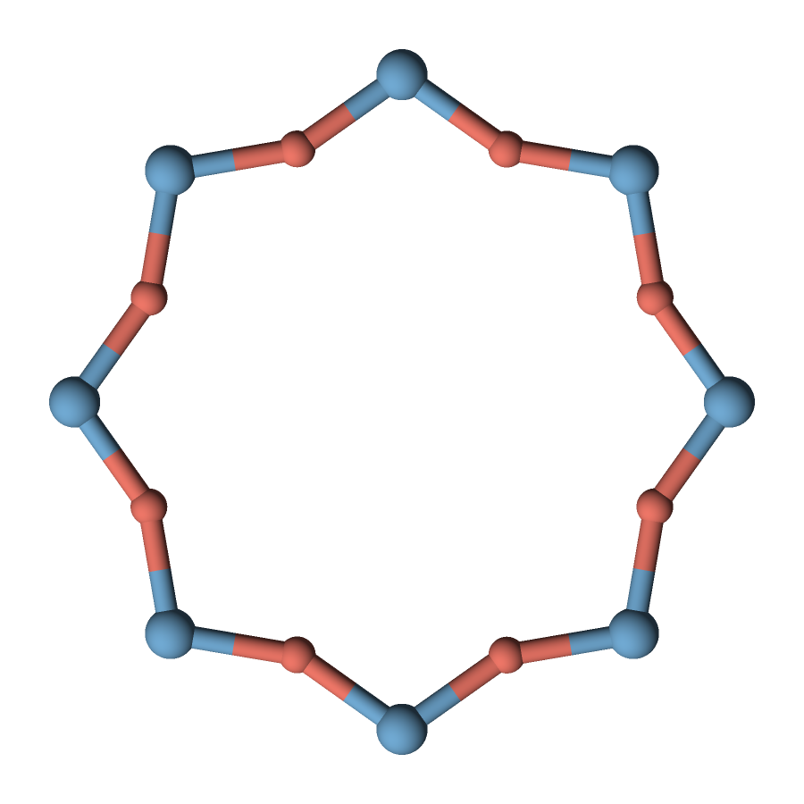
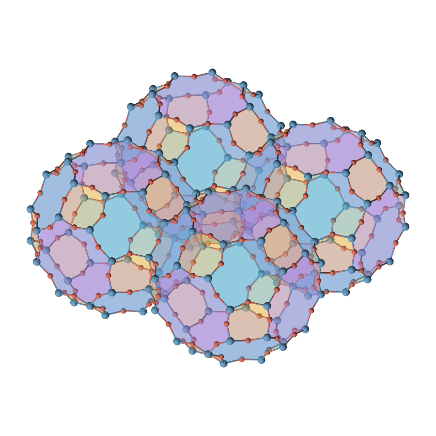

# Zeolite faces, bond colors and thickness

These images were produced by QASR. Open the [comparison sheet](renders/preview.png)
or the individual full-size images below. Blue atoms are Si, coral atoms are O.
The [corrected cage review](renders/cage-review.png) focuses on the complete cage
and polygon boundaries that include every bridging oxygen.

| Complete LTA α-cage | Supplied Si–O polygon faces |
| --- | --- |
|  |  |

| One translucent face | The same face, opaque |
| --- | --- |
|  |  |

| Uniform grey bonds | Atom-colored half-bonds |
| --- | --- |
|  |  |

| Radius 0.035 Å (diameter 0.070 Å) | Radius 0.140 Å (diameter 0.280 Å) |
| --- | --- |
|  |  |



## Try or regenerate

Complete config files are beside their PNGs. Face definitions are in
[single-face.json](single-face.json), [tiles.json](tiles.json) and
[repeated-tiles.json](repeated-tiles.json). Every boundary alternates Si and O.
Use `tiles.json` with [cage.xyz](cage.xyz), and `repeated-tiles.json` with
[cages-2x2.xyz](cages-2x2.xyz). The periodic catalog
[all-ring-faces.json](all-ring-faces.json) and cage definition
[tiles-periodic.json](tiles-periodic.json) use the 72-atom
[POSCAR](POSCAR.LTA) plus explicit image offsets; they require sufficient periodic
atom context to display entire boundary-crossing cages.
The [feature guide](../../docs/polygon-faces.md)
also shows explicit-coordinate polygons.

From the repository root:

```sh
cmake -S . -B build -DCMAKE_BUILD_TYPE=Release
cmake --build build --parallel
python3 tools/render_zeolite_examples.py build/qasr
```

The generator uses Python's standard library. Optional Pillow adds the labeled
comparison sheet; it is not required for QASR or the individual renders.
The helper is specifically for this CIF, not a general CIF importer. QASR reads
the converted XYZ cage/cluster/ring or the periodic POSCAR.

## Geometry and provenance

[LTA.cif](LTA.cif) was obtained from the
[IZA Structure Commission's Database of Zeolite Structures](https://europe.iza-structure.org/IZA-SC/framework_coord.php?ID=138)
([CIF download](https://europe.iza-structure.org/IZA-SC/download_cif.php?ID=138)),
accessed 2026-10-31. Credit: Ch. Baerlocher and L. B. McCusker / IZA-SC.
The source describes DLS76-optimized idealized pure-silica geometry, with cubic
cell length 11.919 Å. Its 48 symmetry operations expand to 24 Si and 48 O atoms.
This is not an experimentally refined sample or simulation result. The original
header is preserved.

The primitive crystallographic cell alone cuts a cage at its boundary. The
corrected example explicitly includes periodic images on both sides to produce
a complete α-cage boundary: **48 Si, 72 bridging O, 144 Si–O bonds and 26 faces**.
Its twelve 4-rings, eight 6-rings and six 8-rings match the α-cage in the
[IZA LTA tiling description](https://america.iza-structure.org/IZA-SC/Tilings/LTA.pdf).
Including oxygen gives those polygons 8, 12 and 16 vertices respectively.

The cage faces are selected as supporting faces of the 48-Si cage shell, then
each Si–Si edge is replaced by the actual Si–O–Si path from the CIF. The generator
and tests verify that every Si–O edge belongs to exactly two faces, all atoms
are connected, and V − E + F = 2. These checks are recorded in
[cage-topology.json](cage-topology.json). No bonds are cut by a unit-cell boundary.
This is an isolated cage boundary; outgoing connections to the rest of the
framework are omitted. The four-cage example includes neighboring cages and
deduplicates their shared atoms and faces.

The full periodic ring catalog remains an illustrative collection, rather than
a claim to enumerate the framework's complete natural tiling. QASR renders
supplied faces without inferring them.

Single-ring views extract one eight-membered Si ring and its eight bridging O
atoms from the same geometry, followed by a rigid translation and rotation.
The single-face polygon includes **all sixteen atoms**, alternating eight Si
and eight O; translucency is retained. These views are isolated to make the
visual differences clear. Reports beside each
image record settings/counts; `renders/manifest.json` records data, generator and
binary hashes and commands. The earlier performance artifacts describe the
earlier binary, not this feature revision.
